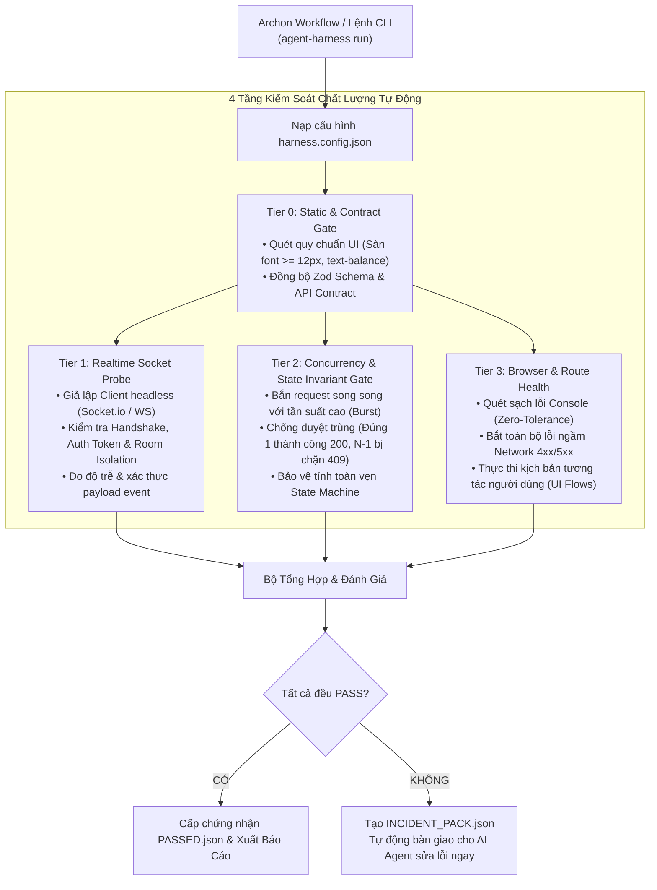

# Agent QA Harness (`agent-qa-harness`)

> **Bộ khung kiểm thử tự động đa tầng (4-Tier Autonomous QA Harness) dành cho AI Agents & Archon Workflows.**  
> Giải quyết triệt để các lỗi tiềm ẩn nguy hiểm trong các dự án full-stack: **"Socket không ăn / mất realtime"**, **"Duyệt sai / Race Condition / Double Approval"**, **"Lỗi ngầm Console / Network 4xx/5xx"**, và **"Lệch chuẩn API Contract & UI Rules"**.

---

## 🎯 Tại sao bạn cần Agent QA Harness?

Khi các lập trình viên hoặc AI Agents (Antigravity, Codex, Orca) phát triển tính năng, các bài unit test thông thường thường bỏ sót các lỗi tích hợp thực tế:
1. **Socket không ăn**: Client không nhận được event realtime do sai tên phòng (`room`), sai namespace, token JWT handshake hết hạn hoặc Redis Pub/Sub bị nghẽn.
2. **Duyệt sai / Tranh chấp (Race Condition)**: Khi 2 người quản trị hoặc 2 thao tác click đồng thời duyệt 1 đơn hàng, hệ thống xử lý trùng lặp (double-approval) làm sai lệch cơ sở dữ liệu.
3. **Lỗi ngầm trình duyệt**: Giao diện nhìn có vẻ bình thường nhưng Console đỏ rực lỗi `TypeError`, lỗi React Hydration mismatch, hoặc các request ngầm trả về `401`, `404`, `500`.
4. **Phá vỡ trải nghiệm Tab**: Link / nút bấm tự ý redirect toàn trang, làm mất bộ lọc và trạng thái đang làm việc.

**Agent QA Harness** tách biệt hoàn toàn giữa **Engine kiểm thử dùng chung** và **Cấu hình riêng của từng dự án**. Chỉ cần đặt một file `harness.config.json` ở thư mục gốc của bất kỳ repository nào, toàn bộ quy trình kiểm thử 4 tầng sẽ tự động kích hoạt.

---

## 💡 Nguyên Tắc Bất Biến: "Thêm Tính Năng Mới = Bổ Sung Ngay Kịch Bản Harness"

Để dự án luôn luôn trơn tru và **không bao giờ bị quên test khi dự án phình to**:
> **Bất kỳ khi nào bạn hoặc AI Agent phát triển xong một tính năng mới (dù là UI, Socket hay API duyệt đơn), BẮT BUỘC phải ghi nhận ngay kịch bản kiểm thử vào `harness.config.json`!**

Harness cung cấp sẵn lệnh thêm nhanh một chạm:
```bash
# 1. Thêm kịch bản kiểm tra giao diện / luồng thao tác người dùng (UI Flow)
agent-harness add:flow "quan-ly-dat-phong"

# 2. Thêm kịch bản kiểm tra realtime socket cho tính năng mới
agent-harness add:socket "thong-bao-nhan-phong"

# 3. Thêm kịch bản kiểm tra chống duyệt trùng / tranh chấp (Race condition)
agent-harness add:concurrency "duyet-hoan-tien"
```
Các kịch bản này sẽ trở thành **Tài sản kiểm thử vĩnh viễn (Living Harness Specs)**. Các lần code sau, Agent chỉ cần chạy `agent-harness run` là kiểm tra lại toàn bộ từ tính năng cũ đến mới, đảm bảo 0% lỗi hồi quy (zero regression).

---

## 🏗️ Kiến trúc Kiểm thử Đa Tầng (4-Tier Test Architecture)



---

## ⚡ Bắt đầu Nhanh (Áp dụng cho mọi Repo trong 60 giây)

### 1. Khởi tạo cấu hình cho dự án
Đứng tại thư mục gốc của repository cần kiểm thử:
```bash
# Tạo file cấu hình mẫu harness.config.json
agent-harness init
```

### 2. Khai báo các kịch bản kiểm thử trong `harness.config.json`
Chỉnh sửa file cấu hình phù hợp với dự án của bạn:
```json
{
  "project": "ten-du-an-cua-ban",
  "baseUrl": "http://localhost:3000",
  "timeoutMs": 30000,

  "static": {
    "enabled": true,
    "commands": [
      {
        "name": "Kiểm tra UI Rules",
        "cmd": "node scripts/verify-ui-rules.cjs"
      }
    ]
  },

  "realtime": {
    "enabled": true,
    "provider": "socket.io",
    "scenarios": [
      {
        "name": "kich-ban-khach-yeu-cau-le-tan-nhan",
        "description": "Khách gửi yêu cầu -> Lễ tân phải nhận được event realtime ngay lập tức",
        "receiver": {
          "endpoint": "/hotel-ops",
          "auth": { "token": "Bearer test-jwt-token" },
          "listenEvent": "REQUEST_CREATED"
        },
        "trigger": {
          "type": "http",
          "method": "POST",
          "path": "/api/v1/guest/requests",
          "body": { "serviceId": "cleaning", "roomId": "101" }
        },
        "timeoutMs": 3000
      }
    ]
  },

  "concurrency": {
    "enabled": true,
    "scenarios": [
      {
        "name": "chong-duyet-trung-don-hang",
        "description": "Bắn 5 request duyệt cùng lúc: Chỉ đúng 1 đơn thành công, 4 đơn còn lại phải bị từ chối",
        "path": "/api/v1/orders/ORD-001/approve",
        "method": "POST",
        "concurrentBurst": 5,
        "assert": {
          "expected200": 1,
          "expectedConflictOrBad": 4
        }
      }
    ]
  },

  "browser": {
    "enabled": true,
    "zeroConsoleErrors": true,
    "zeroNetworkErrors": true,
    "routes": [
      { "path": "/dashboard", "waitForSelector": "[data-testid='metrics-board']" },
      { "path": "/orders", "waitForSelector": "table" }
    ],
    "flows": [
      {
        "name": "luong-dang-nhap-va-xem-bao-cao",
        "steps": [
          { "action": "navigate", "url": "/login" },
          { "action": "waitFor", "durationMs": 300 },
          { "action": "assertNoErrors" }
        ]
      }
    ]
  }
}
```

### 3. Thực thi kiểm thử
```bash
# Chạy toàn bộ 4 Tier kiểm thử
agent-harness run

# Hoặc chỉ chạy riêng từng phần khi đang code tính năng:
agent-harness probe:socket         # Chỉ test Realtime Socket
agent-harness probe:concurrency    # Chỉ test Duyệt trùng & Tranh chấp
agent-harness probe:browser        # Chỉ quét Route & Lỗi giao diện
```

---

## 🤖 Tích hợp Archon Workflow DAG

Copy file template `templates/archon/universal-qa-harness.yaml` vào thư mục `.archon/workflows/` của dự án:

```yaml
name: universal-qa-harness
description: Universal Multi-Project Autonomous QA Harness for Archon
interactive: false

nodes:
  - id: check-config
    bash: |
      test -f harness.config.json || exit 1

  # Chạy song song các làn kiểm thử
  - id: lane-socket
    bash: agent-harness --tier 1
    depends_on: [check-config]

  - id: lane-concurrency
    bash: agent-harness --tier 2
    depends_on: [check-config]

  - id: lane-browser
    bash: agent-harness --tier 3
    depends_on: [check-config]

  # Đánh giá kết quả
  - id: evaluate
    bash: |
      if [ -f "harness-out/INCIDENT_PACK.json" ]; then
        cat harness-out/INCIDENT_PACK.json
        exit 1
      fi
      cat harness-out/HARNESS_REPORT.md
    depends_on: [lane-socket, lane-concurrency, lane-browser]
```

Kích hoạt dễ dàng qua Archon:
```bash
archon run .archon/workflows/universal-qa-harness.yaml
```

---

## 🛡️ Cơ chế Tự Phục Hồi (Self-Healing Incident Pack)

Khi phát hiện lỗi ở bất kỳ tầng nào, Harness không chỉ báo `FAILED` vô nghĩa, mà tự động ghi nhận đầy đủ chứng cứ vào file **`harness-out/INCIDENT_PACK.json`**:

```json
{
  "status": "FAILED",
  "project": "vietsage",
  "failedModules": ["realtime"],
  "failures": [
    {
      "tier": "realtime",
      "target": "kich-ban-khach-yeu-cau-le-tan-nhan",
      "error": "Socket timeout after 3000ms. Event 'REQUEST_CREATED' was never received at endpoint 'http://localhost:3000/hotel-ops'."
    }
  ],
  "instructionsForAgent": [
    "Đọc file INCIDENT_PACK.json để xác định chính xác tầng và kịch bản gặp lỗi.",
    "Kiểm tra Gateway Socket tương ứng (tên phòng room, token handshake, payload).",
    "Áp dụng bản sửa đổi tối thiểu và không sửa các file ngoài phạm vi.",
    "Chạy lại: agent-harness probe:socket để xác nhận lỗi đã được khắc phục triệt để."
  ]
}
```

Nhờ file chuẩn hóa này, các AI Agent có thể **tự động đọc hiểu, định vị file lỗi và sửa ngay lập tức** mà không cần con người phải ngồi debug thủ công.

---

## 📖 Tài Liệu Tham Khảo Thêm
- [Chi tiết Kiến trúc Hệ thống (ARCHITECTURE.md)](docs/ARCHITECTURE.md)
- [Đặc tả toàn bộ trường cấu hình (CONFIG_SPEC.md)](docs/CONFIG_SPEC.md)
- [Sổ tay hành động độc lập cho AI Agents (AGENT_PLAYBOOK.md)](docs/AGENT_PLAYBOOK.md)

---

## 📄 Giấy phép
Bản quyền © 2026 [dangminhdev0403](https://github.com/dangminhdev0403). Phát hành dưới giấy phép MIT.
