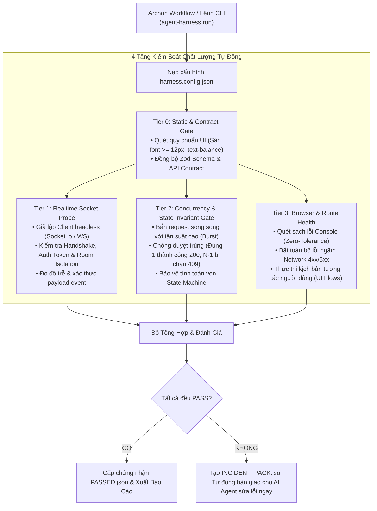

# Agent QA Harness (`agent-qa-harness`)

> **Bộ khung kiểm thử tự động đa tầng (4-Tier Autonomous QA Harness) dành cho AI Agents & Archon Workflows.**  
> Giải quyết triệt để các lỗi tiềm ẩn nguy hiểm trong các dự án full-stack: **"Socket không ăn / mất realtime"**, **"Duyệt sai / Race Condition / Double Approval"**, **"Lỗi ngầm Console / Network 4xx/5xx"**, và **"Lệch chuẩn API Contract & UI Rules"**.

[](https://github.com/dangminhdev0403/agent-qa-harness/blob/master/LICENSE)
[](https://nodejs.org)
[](https://github.com/dangminhdev0403/agent-qa-harness)

---

## 📑 Mục Lục
1. [Tại sao cần Agent QA Harness?](#-tại-sao-cần-agent-qa-harness)
2. [Nguyên Tắc Bất Biến: Living Harness Contract](#-nguyên-tắc-bất-biến-thêm-tính-năng-mới--bổ-sung-ngay-kịch-bản-harness)
3. [Kiến Trúc Kiểm Thử 4 Tầng](#-kiến-trúc-kiểm-thử-đa-tầng-4-tier-test-architecture)
4. [Bắt Đầu Nhanh (Quickstart 60 Giây)](#-bắt-đầu-nhanh-áp-dụng-cho-mọi-repo-trong-60-giây)
5. [Tích Hợp Archon Workflow DAG](#-tích-hợp-archon-workflow-dag)
6. [Cơ Chế Tự Phục Hồi (Self-Healing Loop)](#-cơ-chế-tự-phục-hồi-self-healing-incident-pack)
7. [Bảng Tra Cứu Lệnh CLI Toàn Cục](#-bảng-tra-cứu-lệnh-cli-toàn-cục)
8. [Tài Liệu Chi Tiết](#-tài-liệu-chi-tiết)

---

## 🎯 Tại sao bạn cần Agent QA Harness?

Khi các lập trình viên hoặc AI Agents (Antigravity, Codex, Orca) phát triển tính năng, các bài unit test thông thường thường bỏ sót các lỗi tích hợp thực tế:
1. **Socket không ăn**: Client không nhận được event realtime do sai tên phòng (`room`), sai namespace, token JWT handshake hết hạn hoặc Redis Pub/Sub bị nghẽn.
2. **Duyệt sai / Tranh chấp (Race Condition)**: Khi 2 người quản trị hoặc 2 thao tác click đồng thời duyệt 1 đơn hàng, hệ thống xử lý trùng lặp (double-approval) làm sai lệch cơ sở dữ liệu.
3. **Lỗi ngầm trình duyệt**: Giao diện nhìn có vẻ bình thường nhưng Console đỏ rực lỗi `TypeError`, lỗi React Hydration mismatch, hoặc các request ngầm trả về `401`, `404`, `500`.
4. **Phá vỡ trải nghiệm Tab**: Link / nút bấm tự ý redirect toàn trang, làm mất bộ lọc và trạng thái đang làm việc.

**Agent QA Harness** tách biệt hoàn toàn giữa **Engine kiểm thử dùng chung** và **Cấu hình riêng của từng dự án**. Chỉ cần đặt một file `harness.config.json` ở thư mục gốc của bất kỳ repository nào, toàn bộ quy trình kiểm thử 4 tầng sẽ tự động kích hoạt.

---

## 💡 Nguyên Tắc Bất Biến: "Thêm Tính Năng Mới = Bổ Sung Ngay Kịch Bản Harness"

Để dự án luôn luôn trơn tru và **không bao giờ bị quên test khi dự án phình to**:
> **Bất kỳ khi nào bạn hoặc AI Agent phát triển xong một tính năng mới (dù là UI, Socket hay API duyệt đơn), BẮT BUỘC phải ghi nhận ngay kịch bản kiểm thử vào `harness.config.json`!**

### 1. Tự Động Quét & Khởi Tạo Dự Án Mới (Zero-Effort Auto-Discover)
Khi bạn bắt đầu ở bất kỳ repository nào, **không cần phải gõ tay cấu hình từng trang hay từng socket**, chỉ cần chạy:
```bash
agent-harness discover
```
Lệnh này sẽ **tự động quét toàn bộ mã nguồn** (Next.js routes, NestJS `@WebSocketGateway`, `@SubscribeMessage`, và các endpoint Mutation nhạy cảm như `/approve`, `/checkout`, `/pay`) để tự động sinh ra kịch bản ban đầu đầy đủ!

### 2. Thêm Nhanh & Tự Động Nâng Cấp (Smart Upgrade & Deduplication)
Khi phát triển hoặc sửa đổi tính năng:
```bash
# Thêm/Nâng cấp kịch bản kiểm tra giao diện / luồng thao tác người dùng (UI Flow)
agent-harness add:flow "quan-ly-dat-phong"

# Thêm/Nâng cấp kịch bản kiểm tra realtime socket cho tính năng mới
agent-harness add:socket "thong-bao-nhan-phong"

# Thêm/Nâng cấp kịch bản kiểm tra chống duyệt trùng / tranh chấp (Race condition)
agent-harness add:concurrency "duyet-hoan-tien"
```

> **🛡️ Cơ chế Lọc Trùng Thông Minh:**  
> Nếu tính năng đã tồn tại, Harness sẽ **tự động nâng cấp (upgrade)** các bước, selector và payload mới nhất thay vì tạo kịch bản trùng lặp. Tuyệt đối không sinh rác cấu hình.

---

## 🏗️ Kiến trúc Kiểm thử Đa Tầng (4-Tier Test Architecture)



---

## ⚡ Bắt đầu Nhanh (Áp dụng cho mọi Repo trong 60 giây)

### 1. Khởi tạo cấu hình cho dự án
Đứng tại thư mục gốc của repository cần kiểm thử:
```bash
# Tự động quét và phát hiện các route, socket, mutation
agent-harness discover
```

### 2. Xem và tinh chỉnh file `harness.config.json`
```json
{
  "project": "ten-du-an-cua-ban",
  "baseUrl": "http://localhost:3000",
  "timeoutMs": 30000,

  "static": {
    "enabled": true,
    "commands": [
      { "name": "Kiểm tra UI Rules", "cmd": "node scripts/verify-ui-rules.cjs" }
    ]
  },

  "realtime": {
    "enabled": true,
    "provider": "socket.io",
    "scenarios": [
      {
        "name": "kich-ban-khach-yeu-cau-le-tan-nhan",
        "receiver": {
          "endpoint": "/hotel-ops",
          "auth": { "token": "Bearer test-jwt-token" },
          "listenEvent": "REQUEST_CREATED"
        },
        "trigger": {
          "type": "http",
          "method": "POST",
          "path": "/api/v1/guest/requests",
          "body": { "serviceId": "cleaning", "roomId": "101" }
        },
        "timeoutMs": 3000
      }
    ]
  },

  "concurrency": {
    "enabled": true,
    "scenarios": [
      {
        "name": "chong-duyet-trung-don-hang",
        "path": "/api/v1/orders/ORD-001/approve",
        "method": "POST",
        "concurrentBurst": 5,
        "assert": { "expected200": 1, "expectedConflictOrBad": 4 }
      }
    ]
  },

  "browser": {
    "enabled": true,
    "zeroConsoleErrors": true,
    "zeroNetworkErrors": true,
    "routes": [
      { "path": "/dashboard", "waitForSelector": "[data-testid='metrics-board']" }
    ],
    "flows": [
      {
        "name": "luong-dang-nhap-va-xem-bao-cao",
        "steps": [
          { "action": "navigate", "url": "/login" },
          { "action": "waitFor", "durationMs": 300 },
          { "action": "assertNoErrors" }
        ]
      }
    ]
  }
}
```

### 3. Thực thi kiểm thử
```bash
# Chạy toàn bộ 4 Tier kiểm thử
agent-harness run

# Hoặc chỉ chạy riêng từng phần khi đang code tính năng:
agent-harness probe:socket         # Chỉ test Realtime Socket
agent-harness probe:concurrency    # Chỉ test Duyệt trùng & Tranh chấp
agent-harness probe:browser        # Chỉ quét Route & Lỗi giao diện
```

---

## 🤖 Tích hợp Archon Workflow DAG

Copy file template `templates/archon/universal-qa-harness.yaml` vào thư mục `.archon/workflows/` của dự án, sau đó kích hoạt:
```bash
archon run .archon/workflows/universal-qa-harness.yaml
```

---

## 🛡️ Cơ chế Tự Phục Hồi (Self-Healing Incident Pack)

Khi phát hiện lỗi ở bất kỳ tầng nào, Harness không chỉ báo `FAILED` vô nghĩa, mà tự động ghi nhận đầy đủ chứng cứ vào file **`harness-out/INCIDENT_PACK.json`**:

```json
{
  "status": "FAILED",
  "project": "vietsage",
  "failedModules": ["realtime"],
  "failures": [
    {
      "tier": "realtime",
      "target": "kich-ban-khach-yeu-cau-le-tan-nhan",
      "error": "Socket timeout after 3000ms. Event 'REQUEST_CREATED' was never received at endpoint 'http://localhost:3000/hotel-ops'."
    }
  ],
  "instructionsForAgent": [
    "Đọc file INCIDENT_PACK.json để xác định chính xác tầng và kịch bản gặp lỗi.",
    "Kiểm tra Gateway Socket tương ứng (tên phòng room, token handshake, payload).",
    "Áp dụng bản sửa đổi tối thiểu và không sửa các file ngoài phạm vi.",
    "Chạy lại: agent-harness probe:socket để xác nhận lỗi đã được khắc phục triệt để."
  ]
}
```

---

## 📋 Bảng Tra Cứu Lệnh CLI Toàn Cục

| Lệnh | Ý nghĩa & Mô tả |
| :--- | :--- |
| `agent-harness discover` | Tự động quét dự án, phát hiện routes, socket gateways, mutations và tạo config |
| `agent-harness run` | Chạy toàn bộ quy trình kiểm thử 4 tầng và xuất báo cáo |
| `agent-harness init` | Khởi tạo file cấu hình trắng `harness.config.json` |
| `agent-harness add:flow <tên>` | Thêm hoặc nâng cấp kịch bản tương tác người dùng (UI Flow) |
| `agent-harness add:socket <tên>` | Thêm hoặc nâng cấp kịch bản kiểm tra Realtime Socket |
| `agent-harness add:concurrency <tên>` | Thêm hoặc nâng cấp kịch bản kiểm tra tranh chấp (chống duyệt trùng) |
| `agent-harness probe:socket` | Chạy riêng rẽ Tier 1 (Realtime Socket Probe) |
| `agent-harness probe:concurrency` | Chạy riêng rẽ Tier 2 (Concurrency Gate) |
| `agent-harness probe:browser` | Chạy riêng rẽ Tier 3 (Chrome & Route Scanner) |
| `agent-harness --tier <0\|1\|2\|3>` | Chạy một Tier cụ thể được chỉ định |
| `agent-harness --config <path>` | Chỉ định file cấu hình tùy chỉnh ở đường dẫn khác |

---

## 📚 Tài Liệu Chi Tiết

- 📐 [**Kiến Trúc Toàn Diện Hệ Thống (ARCHITECTURE.md)**](docs/ARCHITECTURE.md): Phân tích chi tiết thuật toán 4 tầng kiểm thử, cơ chế đo độ trễ socket và burst concurrency.
- ⚙️ [**Đặc Tả File Cấu Hình (CONFIG_SPEC.md)**](docs/CONFIG_SPEC.md): Bảng tra cứu toàn bộ tham số trong `harness.config.json`.
- 🤖 [**Sổ Tay Hành Động Độc Lập Cho AI Agents (AGENT_PLAYBOOK.md)**](docs/AGENT_PLAYBOOK.md): Cẩm nang tự sửa lỗi và tương tác Chrome DevTools MCP dành cho Agent.
- 📜 [**Quy Tắc Bắt Buộc Toàn Cục (AGENT_HARNESS_GLOBAL_RULE.md)**](rules/AGENT_HARNESS_GLOBAL_RULE.md): Khối quy tắc copy-paste dành cho `.agents/AGENTS.md`.

---

## 📄 Giấy phép
Bản quyền © 2026 [dangminhdev0403](https://github.com/dangminhdev0403). Phát hành dưới giấy phép MIT.
