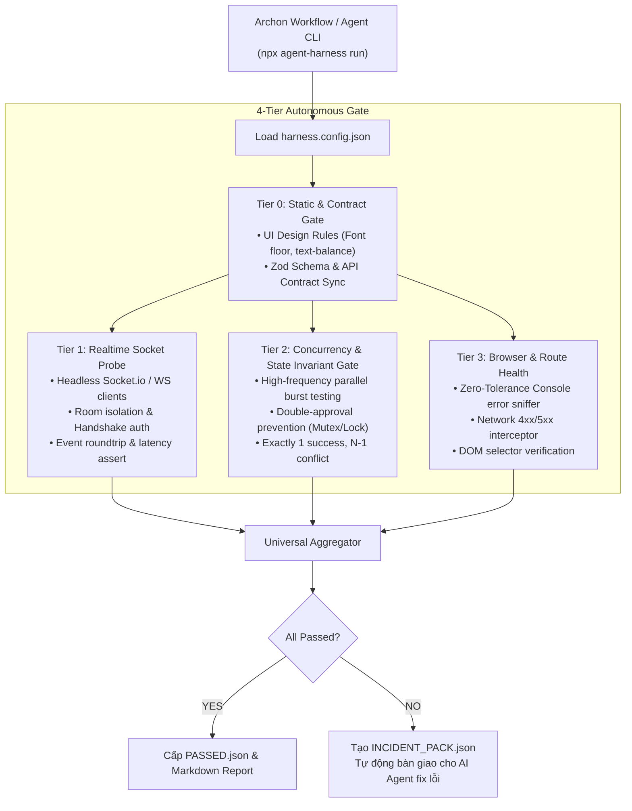

# Universal Autonomous QA Harness (`agents-testing-with-workflow`)

> **Universal 4-Tier Autonomous Testing & Validation Engine for AI Agents & Archon Workflows.**  
> Designed to eliminate subtle production bugs: dropped realtime sockets, race conditions / double approvals, silent browser console crashes, and API contract drifts across any codebase.

---

##  Why This Exists

When AI coding agents (Antigravity, Codex, Orca) work on full-stack applications, standard unit tests often fail to catch real-world runtime regressions:
- **"Socket không ăn"**: Realtime events silently dropped due to namespace mismatches, Redis pub/sub desync, or expired auth handshakes.
- **"Duyệt sai / Race Condition"**: State machines breaking when multiple parallel approvals hit an endpoint simultaneously.
- **"Lỗi console & Network ngầm"**: Uncaught React hydration errors, 4xx/5xx network failures that go unnoticed during manual testing.

**`agents-testing-with-workflow`** solves this by providing a **declarative, repository-agnostic test harness**. Drop a single `harness.config.json` into any repo, and the harness orchestrates a rigorous 4-tier validation pipeline.

---

## 🏗️ 4-Tier Test Architecture



---

## ⚡ Quick Start (Any Project in 60s)

### 1. Initialize Configuration in Your Repo
Run inside your target repository:
```bash
npx agent-harness init
```
This generates a starter `harness.config.json`.

### 2. Configure Your Endpoints & Scenarios
Customize `harness.config.json`:
```json
{
  "project": "my-app",
  "baseUrl": "http://localhost:3000",
  "realtime": {
    "enabled": true,
    "provider": "socket.io",
    "scenarios": [
      {
        "name": "guest-to-receptionist-request",
        "receiver": {
          "endpoint": "/hotel-ops",
          "listenEvent": "REQUEST_CREATED"
        },
        "trigger": {
          "type": "http",
          "method": "POST",
          "path": "/api/v1/guest/requests",
          "body": { "service": "laundry" }
        },
        "timeoutMs": 3000
      }
    ]
  },
  "concurrency": {
    "enabled": true,
    "scenarios": [
      {
        "name": "prevent-double-approval",
        "path": "/api/v1/orders/123/approve",
        "concurrentBurst": 5,
        "assert": { "expected200": 1, "expectedConflictOrBad": 4 }
      }
    ]
  },
  "browser": {
    "enabled": true,
    "zeroConsoleErrors": true,
    "routes": ["/dashboard", "/orders"]
  }
}
```

### 3. Run the Harness
```bash
npx agent-harness run
```

Or run targeted probes during development:
```bash
npx agent-harness probe:socket         # Test only realtime socket events
npx agent-harness probe:concurrency    # Test race conditions & approvals
npx agent-harness probe:browser        # Scan routes for console/network bugs
```

---

## 🤖 Archon Workflow Integration

Copy `templates/archon/universal-qa-harness.yaml` into your repository's `.archon/workflows/`:

```bash
archon run .archon/workflows/universal-qa-harness.yaml
```

Archon coordinates the parallel test lanes, monitors execution, and halts automatically if any failure is detected.

---

## 🛡️ Autonomous Self-Healing with AI Agents

When a test fails, `agents-testing-with-workflow` does not just print a generic error. It writes an **`INCIDENT_PACK.json`** inside `harness-out/`:

```json
{
  "status": "FAILED",
  "project": "vietsage",
  "failedModules": ["realtime"],
  "failures": [
    {
      "tier": "realtime",
      "target": "guest-to-receptionist-request",
      "error": "Socket timeout after 3000ms. Event 'REQUEST_CREATED' was never received at endpoint 'http://localhost:3000/hotel-ops'."
    }
  ],
  "instructionsForAgent": [
    "Read this INCIDENT_PACK.json to identify the failing tier and scenario.",
    "Locate the affected file or gateway indicated in the failure details.",
    "Apply the targeted fix without modifying unrelated code or package.json.",
    "Re-run: npx agent-harness probe:socket to verify the fix."
  ]
}
```

AI agents can directly read this file, diagnose the root cause, apply the fix, and verify it autonomously.

---

## 📚 Documentation
- [Architecture & Design Details](docs/ARCHITECTURE.md)
- [harness.config.json Specification](docs/CONFIG_SPEC.md)
- [AI Agent Autonomous Playbook](docs/AGENT_PLAYBOOK.md)

---

## 📄 License
MIT © 2026 [dangminhdev0403](https://github.com/dangminhdev0403)
