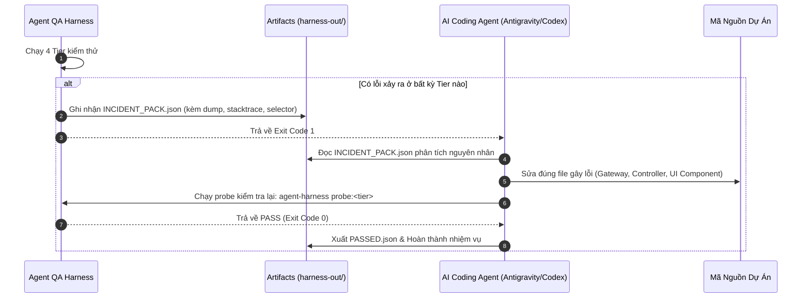

# Kiến Trúc Toàn Diện Hệ Thống: Agent QA Harness

> **Tài liệu đặc tả kiến trúc kỹ thuật nội bộ của `agent-qa-harness`**  
> Thiết kế phục vụ việc kiểm thử, xác thực và tự phục hồi lỗi tự động cho các AI Coding Agents (Antigravity, Codex, Orca) và kỹ sư phần mềm.

---

## 1. Triết Lý & Vấn Đề Cốt Lõi

Trong các hệ thống full-stack hiện đại (microservices, monolith, realtime web apps), các công cụ test truyền thống (Jest, Vitest, Cypress) thường bộc lộ 3 nhược điểm lớn:
1. **Quá phụ thuộc vào môi trường cụ thể (Coupled)**: Mỗi repo phải tự cấu hình lại framework, mock server, khiến AI Agent dễ làm vỡ cấu hình khi chỉnh sửa.
2. **Không bắt được lỗi tích hợp ngầm (Silent Runtime Failures)**:
   - **Socket không ăn**: Client kết nối được nhưng không nhận event do sai `room`, lệch namespace, token JWT handshake hết hạn hoặc Redis Pub/Sub bị nghẽn.
   - **Duyệt sai / Race Condition**: State machine vỡ khi có 2 request duyệt đồng thời (double-approval) vì thiếu Database Mutex/Pessimistic Lock.
   - **Lỗi ngầm Console / Network 4xx/5xx**: Màn hình vẫn render nhưng console đỏ rực lỗi JS, hoặc ngầm gọi API 404/500 mà user không biết.
3. **Thiếu khả năng tự phục hồi (Self-Healing Loop)**: Khi test fail, hệ thống chỉ báo đỏ chung chung, AI Agent không có dữ liệu chẩn đoán cụ thể (payload, network dump, stack trace) để tự fix.

**Agent QA Harness** giải quyết triệt để bằng mô hình **Engine Độc Lập (Decoupled Engine) + Khai Báo Cấu Hình (`harness.config.json`) + Gói Báo Lỗi Chuẩn Hóa (`INCIDENT_PACK.json`)**.

---

## 2. Kim Tự Tháp Kiểm Thử 4 Tầng (4-Tier Test Pyramid)

```
┌────────────────────────────────────────────────────────────────────────┐
│  Tier 3: Browser & Route Scanning (0-Console Error, 0-Net 4xx/5xx)     │
│  • Quét giao diện, bắt toàn bộ unhandled exceptions, chạy UI Flows     │
├────────────────────────────────────────────────────────────────────────┤
│  Tier 2: Concurrency & State Invariants Gate (Burst Parallelism)       │
│  • Bắn đồng thời N request trong 1 microsecond, chống duyệt trùng       │
├────────────────────────────────────────────────────────────────────────┤
│  Tier 1: Realtime Socket Probe (Handshake, Rooms, Latency)             │
│  • Headless Client (Socket.io/WS) đo event roundtrip, kiểm tra room    │
├────────────────────────────────────────────────────────────────────────┤
│  Tier 0: Static & Contract Gates (UI Rules, Zod, TypeCheck)            │
│  • Kiểm tra tĩnh sàn font >= 12px, cân bằng chữ, Zod schema contract   │
└────────────────────────────────────────────────────────────────────────┘
```

---

### Chi Tiết Kỹ Thuật Từng Tầng:

### Tier 0: Static & Contract Gate (`static-runner.mjs`)
- **Mục tiêu**: Chặn đứng các lỗi cú pháp, kiểu dữ liệu và vi phạm thiết kế giao diện trong vòng chưa đầy **3 giây**.
- **Cơ chế**:
  - Thực thi các lệnh kiểm tra tĩnh được khai báo trong `static.commands`.
  - Quét tĩnh các lỗi thiết kế: Sàn font chữ micro-classes (`text-[10px]`, `text-[11px]`), thiếu `text-balance` trên tiêu đề, vi phạm WCAG AA contrast.
  - Kiểm tra tính tương thích giữa Zod Schema backend và TypeScript models frontend.

---

### Tier 1: Realtime Socket Probe (`socket-probe.mjs`)
- **Mục tiêu**: Đảm bảo 100% các sự kiện realtime hoạt động thông suốt từ backend đến client.
- **Quy trình Probe 4 bước**:
  1. **Khởi tạo Headless Client**: Kết nối đến endpoint Socket (hỗ trợ cả Socket.io và Native WebSocket) với JWT Token/Auth Headers thực tế.
  2. **Gia nhập Phòng & Kích hoạt Listener**: Đăng ký lắng nghe sự kiện mục tiêu (`listenEvent`) và đặt bộ đếm thời gian `timeoutMs`.
  3. **Bắn Hành Động Kích Hoạt (Trigger)**: Gọi API REST hoặc Socket Emit để tạo sự kiện nghiệp vụ (ví dụ: Khách tạo yêu cầu giặt là qua `POST /api/v1/guest/requests`).
  4. **Kiểm duyệt Payload & Latency**:
     - Bắt sự kiện nhận được từ socket lễ tân.
     - So khớp payload với cấu trúc khai báo (`assertPayload`).
     - Đo độ trễ (latency) tính bằng mili-giây.
     - Nếu hết `timeoutMs` mà không nhận được event $\rightarrow$ Báo lỗi cụ thể (sai room, sai namespace hoặc event dropped).

---

### Tier 2: Concurrency & Idempotency Gate (`concurrency-gate.mjs`)
- **Mục tiêu**: Loại trừ tận gốc lỗi **Duyệt sai**, **Duyệt trùng (Double-approval)** và **Race Condition** trong giao dịch.
- **Thuật toán High-Frequency Burst**:
  1. Chuẩn bị $N$ request đồng thời (mặc định $N = 5$) nhắm vào cùng 1 tài nguyên (ví dụ: cùng duyệt Order `#ORD-101`).
  2. Tự động bơm mã định danh client duy nhất (`X-Client-Request-Id`) vào từng request nếu cấu hình yêu cầu.
  3. Bắn toàn bộ bằng `Promise.all` trong cùng một micro-giây.
  4. Thu thập toàn bộ HTTP Response Status phân phối:
     $$\text{Phân phối chuẩn: } 1 \times \text{HTTP 200 (Thành công)} \quad \text{và} \quad (N-1) \times \text{HTTP 409 / 400 (Từ chối)}$$
  5. Nếu có từ 2 request trở lên trả về HTTP 200 $\rightarrow$ **Cảnh báo LỖI NGHIÊM TRỌNG: Thiếu Mutex / Database Transaction Lock**.

---

### Tier 3: Browser & Route Health Scanner (`chrome-scanner.mjs` & `chrome-flow-runner.mjs`)
- **Mục tiêu**: Kiểm tra tính ổn định của giao diện người dùng và bắt sạch các lỗi runtime ngầm.
- **2 Chế độ hoạt động**:
  1. **Quét Route Tĩnh & Giám Sát Mã Lỗi**:
     - Thăm dò toàn bộ các route khai báo trong `browser.routes`.
     - Phân tích mã nguồn HTML render để phát hiện các mẫu lỗi chết người (`Application error`, `Unhandled Runtime Error`, `SyntaxError`).
  2. **Thực thi Kịch bản Tương tác (UI Action Flows)**:
     - Thực hiện chuỗi hành động mô phỏng người dùng: `navigate` $\rightarrow$ `fill` $\rightarrow$ `click` $\rightarrow$ `waitFor` $\rightarrow$ `assertText`.
     - Bắt buộc kiểm tra 2 cổng chặn vàng:
       - **Console Zero-Tolerance**: Bắt mọi `console.error`, React Hydration Error, Uncaught Exception.
       - **Network Sniffer**: Bắt mọi request API ngầm trả về mã `4xx` hoặc `5xx`.
     - Chụp ảnh màn hình lưu vào thư mục `harness-out/screenshots/`.

---

## 3. Kiến Trúc Tự Phục Hồi (Autonomous Self-Healing Loop)



### Cấu Trúc File `INCIDENT_PACK.json`:
Khi có sự cố, Harness tạo ra một gói dữ liệu chẩn đoán hoàn chỉnh giúp AI Agent sửa lỗi ngay mà không cần đoán mò:

```json
{
  "status": "FAILED",
  "project": "vietsage",
  "timestamp": "2026-10-21T03:30:00.000Z",
  "failedModules": ["realtime"],
  "failures": [
    {
      "tier": "realtime",
      "target": "thong-bao-dat-phong",
      "error": "Socket timeout after 3000ms. Event 'BOOKING_CREATED' was never received at endpoint 'http://localhost:3000/hotel-ops'."
    }
  ],
  "instructionsForAgent": [
    "Đọc file INCIDENT_PACK.json để xác định chính xác tầng và kịch bản gặp lỗi.",
    "Kiểm tra Gateway Socket tương ứng (tên phòng room, token handshake, payload).",
    "Áp dụng bản sửa đổi tối thiểu và không sửa các file ngoài phạm vi.",
    "Chạy lại: agent-harness probe:socket để xác nhận lỗi đã được khắc phục triệt để."
  ]
}
```

---

## 4. Tích Hợp Đa Nền Tảng (Archon, Terminal, CI-CD)

- **Archon Workflow**: Thực thi thông qua workflow DAG (`universal-qa-harness.yaml`), chia nhánh song song các làn kiểm thử và hội tụ tại node đánh giá cuối cùng.
- **Terminal CLI Toàn Cục**: Đăng ký qua `npm link` hoặc `npm install -g`, sử dụng lệnh `agent-harness` ở bất kỳ thư mục nào trên hệ điều hành.
- **Zero-Dependency Core**: Toàn bộ hệ thống CLI khởi động với 0 dependency nặng; các module mở rộng như `socket.io-client` chỉ được nạp động (lazy dynamic import) khi kịch bản yêu cầu.
